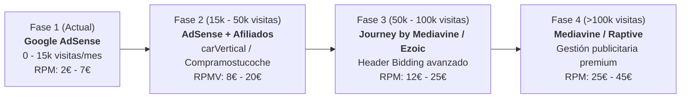

# 11. Estrategia de Monetización Publicitaria y Crecimiento de Tráfico para Ododex

> **Hito alcanzado:** Google AdSense ha aprobado oficialmente la red Ododex (`ododex.com`).  
> **Fecha:** Noviembre de 2026.  
> **Objetivo:** Maximizar el rendimiento por mil visitas (RPM / eCPM) preservando la velocidad y experiencia de usuario, e implementar las palancas de adquisición para escalar el tráfico orgánico a más de 100.000 visitas mensuales.

---

## 1. Diagnóstico del Sector: El Nicho Automoción y Trámites en España

El sector del automóvil, los carburantes, los impuestos y las sanciones administrativas presenta uno de los **CPC (Coste por Clic) y RPM más elevados de la publicidad digital en España**:

| Temática en Ododex | Anunciantes Competidores en Google Ads | Rango Estimado de CPC | RPM Potencial (AdSense) |
|---|---|---|---|
| **Impuestos y Transferencias (`/es/impuestos`)** | Gestorías online, bancos (préstamos coche), compraventas, plataformas de tasación | **0,45 € – 1,80 €** | **8 € – 18 €** |
| **Multas y Radares (`/es/multas`)** | Abogados especialistas en recurrir multas (Dvuelta, Pyramid, Legálitas), aseguradoras | **0,60 € – 2,20 €** | **7 € – 15 €** |
| **ZBE y Etiquetas DGT (`/es/zbe`)** | Concesionarios (Plan Renove, vehículos ECO/CERO), renting, compraventas | **0,35 € – 1,10 €** | **5 € – 12 €** |
| **Llamadas a Revisión (`/es/llamadas-revision`)** | Talleres mecánicos, venta de recambios, peritos judiciales | **0,30 € – 0,90 €** | **4 € – 9 €** |
| **Gasolineras y Carburantes (`/es/gasolineras`, `/fr/...`)** | Tarjetas de fidelización, petroleras, seguros de coche, apps de pago móvil | **0,15 € – 0,45 €** | **2 € – 6 €** |
| **Puntos de Recarga (`/es/puntos-recarga`)** | Instaladores de cargadores domésticos (Wallbox, Iberdrola, Endesa), coches eléctricos | **0,50 € – 1,60 €** | **6 € – 14 €** |
| **Transporte Urbano (`/es/zaragoza-bus`, `/es/tranvia-...`)** | Comercio local, eventos, telecomunicaciones, apps de movilidad | **0,10 € – 0,30 €** | **1 € – 3 €** |

---

## 2. Estrategia de Monetización Vía Anuncios (AdSense y Redes Publicitarias)

### 2.1. Anatomía y Posicionamiento Óptimo de los Bloques (`AdSlot`)

Para ganar dinero con AdSense, la métrica clave no es cuántos anuncios pongas, sino el **Viewability Rate (tasa de visibilidad > 70%)** y el **CTR (Click-Through Rate)**. Si colocas un anuncio en el pie de página que nadie ve, Google lo penaliza con pujas basura (0,01 €).

#### A. El Bloque de Oro: "Below the Tool Result" (Inmediatamente tras el resultado)
- **Dónde:** Justo debajo del resultado del cálculo en la calculadora de multas, del importe de ITP en impuestos o de la tabla de mejores gasolineras.
- **Por qué funciona:** El usuario introduce sus datos (ej. velocidad 88 km/h en límite 50) y su mirada se detiene durante 3-6 segundos analizando el resultado. El anuncio situado justo debajo tiene una visibilidad del 85-92% y un CTR muy alto hacia servicios complementarios (ej. recurso de multas o seguros).
- **Formato:** Adaptable (*Responsive Display*), ocupando el 100% del ancho del contenedor.

#### B. Bloques "In-Feed" entre Listados Largos
- **Dónde:** En las páginas de carreteras con muchos radares, en el listado de municipios de una provincia en gasolineras o entre los modelos de una marca en llamadas a revisión.
- **Regla:** Insertar un bloque publicitario cada 6-8 elementos de la lista.
- **Ventaja:** No corta la lectura bruscamente, se integra con el diseño y genera impresiones naturales a medida que el usuario hace scroll.

#### C. Anuncios Laterales Fijos en Escritorio (Side Rails)
- En pantallas grandes (`min-width: 1280px`), la web deja márgenes libres a izquierda y derecha del contenedor central (`max-w-7xl` o `max-w-4xl`).
- Los **Side Rails** se quedan fijos en los laterales mientras el usuario navega por las tablas. Son los bloques con mayor tiempo de permanencia activa (viewability > 85%) y pagan un CPM muy superior sin invadir el contenido.
- **Activación:** Se activan con un solo clic desde el panel de AdSense en *Anuncios automáticos > Formatos de página ancha > Anuncios de riel lateral*.

#### D. Anuncios Viñeta (Vignette Ads / Intersticiales Entre Páginas)
- **Qué son:** Anuncios a pantalla completa que aparecen al cambiar de una página a otra (ej. de la portada de multas a la ficha de la A-2, o de la lista de marcas de llamadas a revisión a un modelo).
- **Rendimiento:** **Son los anuncios mejor pagados de todo Google AdSense** (RPMs de entre 15 € y 45 €).
- **Control de molestia:** En el panel de Google AdSense se debe configurar la **frecuencia máxima** (Frequency Capping) a **1 viñeta cada 10 minutos por usuario**. De este modo el usuario no se siente bombardeado, pero cada visitante que navega por 2-3 herramientas genera una impresión de alto valor.

---

### 2.2. Optimización Avanzada del Panel de Google AdSense

Una vez aprobado el sitio, el rendimiento por defecto suele ser mediocre si no se configuran los controles de puja:

1. **Optimización de Subastas y Google Ad Exchange:**
   - En *Seguridad de la marca > Controles de bloqueo*, verificar que las subastas abiertas (*Open Bidding*) y los compradores de terceros de Google Ad Exchange están habilitados para pujar en tiempo real (First-Price Auction).
2. **Bloqueo Selectivo de Categorías Basura:**
   - Bloquear categorías de bajo valor que devalúan el inventario: *Descarga de software dudoso, astrología/esoterismo, citas para adultos, juegos de azar de baja calidad*.
   - Permitir y priorizar: *Finanzas, Seguros, Vehículos y motor, Asesoría jurídica, Energía y suministros*.
3. **Control del CLS (Cumulative Layout Shift):**
   - Los bloques manuales `AdSlot` deben reservar una altura mínima fija con CSS (`min-h-[250px]` o `min-h-[280px]`) para que la página no dé un salto al cargarse el anuncio. Google Search Console penaliza en el ranking las páginas con saltos de maquetación.
4. **Consentimiento de Cookies (CMP) Conforme a TCF 2.2 de IAB:**
   - La red Ododex ya cuenta con el script de cookies y enlace legal. Al monetizar con AdSense en Europa, es obligatorio activar la plataforma de gestión de consentimiento (CMP de Google) desde el menú *Privacidad y mensajes* de AdSense para no perder hasta el 60% de los ingresos de usuarios europeos.

---

### 2.3. La Evolución de Ingresos: El Camino Más Allá de AdSense

AdSense es el primer paso ideal para validar la monetización sin requisitos de tráfico mínimo. Sin embargo, para escalar la facturación conforme crezca el tráfico, la ruta recomendada es:



---

## 3. Plan Maestro para Multiplicar el Tráfico Orgánico y la Facturación

Tener anuncios configurados en una web sin visitas genera 0 €. La verdadera máquina de ingresos radica en canalizar cientos de miles de búsquedas mensuales que se producen en Google hacia las herramientas de Ododex.

### 3.1. Indexación Acelerada del SEO Programático en Google Search Console

Ododex cuenta con una red de cerca de **70.000 páginas útiles**, pero Googlebot no las rastrea todas de inmediato sin una estrategia proactiva:

1. **Envío del Sitemap Index Maestro:**
   - Enviar en Google Search Console la URL raíz: `https://ododex.com/sitemap.xml`.
   - Este sitemap index ya reúne las 12 secciones oficiales (`/es/gasolineras`, `/es/multas`, `/es/impuestos`, `/es/zbe`, `/es/puntos-recarga`, `/es/llamadas-revision`, `/fr/prix-carburants`, etc.).
2. **Monitorización de Cobertura Semanal:**
   - Supervisar en GSC la pestaña *Páginas > Indexadas vs Excluidas*.
   - Prestar atención a las URL bajo la etiqueta *"Rastreada: actualmente sin indexar"*. Las mejoras de thin content y enlaces internos que hemos implementado resuelven directamente este cuello de botella.
3. **Poder de la Malla Relacional (`red-enlaces.json`):**
   - Los cruces entre gasolineras, cargadores y ZBE de un mismo municipio hacen que cada vez que Googlebot rastrea una gasolinera en Huesca o Vigo, descubra y valide los puntos de recarga y las normativas ZBE de esa misma localidad sin abandonar el dominio.

---

### 3.2. Explotación de Intenciones de Búsqueda de Alto Tráfico Estacional

El tráfico del motor y la movilidad tiene picos gigantescos en momentos muy concretos del año. Preparar la web para estos picos multiplica los ingresos mensuales:

| Evento / Momento del Año | Sección Clave | Búsquedas que Explotan | Acción Específica |
|---|---|---|---|
| **Operación Salida (Semana Santa, Puentes, 1 Julio, 1 Agosto)** | `gasolineras`, `multas` | *"dónde está la gasolina más barata", "radares tramo A-3", "multa radar velocidad"* | Banner temporal en la portada de Ododex destacando las autovías principales hacia playas y destinos turísticos. |
| **Entrada en Vigor de Nuevas ZBE (1 de Enero)** | `zbe-map` | *"puedo entrar en Madrid sin etiqueta", "ZBE Bilbao 2026", "multa por entrar en ZBE"* | Actualización de fechas de moratoria y publicación de guías rápidas de distintivo. |
| **Campañas de Notificaciones de Seguridad (Todo el año)** | `recalls-web` | *"aviso citroen airbags c3", "llamada revision seat", "campaña toyota"* | Posicionamiento en Google News y Discover al publicar de forma estructurada las alertas oficiales del Safety Gate de la UE. |
| **Campaña de Compraventa de Vehículos Usados (Marzo – Junio / Octubre – Noviembre)** | `calculadora-impuestos` | *"cuanto se paga de ITP coche", "tablas hacienda vehiculos 2026", "calcular transferencia coche"* | Guías autonómicas enriquecidas con tablas de depreciación por antigüedad (BOE). |

---

### 3.3. Estrategia de Adquisición de Enlaces Naturales (*Link Baiting*)

Para que Google sitúe a Ododex en el Top 3 de palabras clave competitivas (*"gasolineras baratas"*, *"calcular itp"*), se requiere autoridad de dominio. La mejor forma de conseguir enlaces de periódicos y foros sin gastar dinero es la publicación de estudios de datos:

1. **Estudios de Datos Abiertos con la DGT y MITECO:**
   - **Idea 1:** *"El mapa de las 50 gasolineras más baratas y más caras de las carreteras de España en 2026"*.
   - **Idea 2:** *"Las 10 carreteras con mayor densidad de radares de la DGT por kilómetro"*.
   - **Idea 3:** *"Informe anual del Safety Gate: las marcas con mayor número de llamadas a revisión en Europa"*.
2. **Difusión en Medios y Comunidades:**
   - Redactar una nota de prensa sencilla con 3 gráficos y enviarla a secciones de motor de cabeceras digitales (Motorpasión, El Motor de El País, HibridosyElectricos, Autobild).
   - Publicar resúmenes en foros especializados: **ForoCoches** (sección General / Motor), **Reddit** (`r/spain`, `r/AskSpain`) y **Menéame**.
   - Estos enlaces desde dominios con autoridad (DA 80+) traspasan fuerza (*PageRank*) a todo `ododex.com`.

---

### 3.4. Activación del Proyecto Estrella Durmiente: `vehicle-stats`

En el repositorio `vehicle-stats` (análisis de microdatos MATRABA de la DGT con más de 5,4 millones de matriculaciones) reside el mayor activo de atracción de tráfico institucional y periodístico:
- Al integrarlo bajo `https://ododex.com/es/estadisticas-dgt` (según las pautas del prompt 12), cualquier periodista o aficionado que busque cuotas de mercado de híbridos, marcas más vendidas por provincia o edad media del parque automovilístico enlazará y citará a Ododex como fuente original.

---

### 3.5. Fidelización y Tráfico Recurrente (Canales Push Gratuitos)

El SEO depende de Google. Para blindar el proyecto y generar tráfico diario predecible:

1. **Canal de Alertas en Telegram / WhatsApp:**
   - *"Alerta Gasolina Barata"*: Un bot o canal que publique los viernes antes del fin de semana las 5 estaciones más económicas de cada provincia.
   - Enlace directo a la ficha de la estación en Ododex con anuncios activos.
2. **Alertas Web Push (OneSignal / Pushpad):**
   - Un botón en la ficha de un modelo en llamadas a revisión: *"Avisarme si [Marca/Modelo] publica una nueva campaña de seguridad"*.
   - Retención a coste 0 que devuelve al usuario recurrente a la web.

---

## 4. Monetización Híbrida: La Capa de Afiliación de Alto Ticket

No limites los ingresos únicamente a los clics de AdSense. Integrar enlaces de afiliación en los puntos clave de decisión multiplica los ingresos por visita (**RPMV**):

```
       ┌────────────────────────────────────────────────────────┐
       │                VISITANTE EN ODODEX                     │
       └──────────────────────────┬─────────────────────────────┘
                                  │
         ┌────────────────────────┼────────────────────────┐
         ▼                        ▼                        ▼
  Busca Multa DGT          Calcula ITP Coche       Revisa Llamada Seguridad
         │                        │                        │
         ▼                        ▼                        ▼
 ┌───────────────┐       ┌─────────────────┐      ┌─────────────────┐
 │ AdSense Clic  │       │ carVertical     │      │ Talleres /      │
 │ (Recurso 50%) │       │ Historial coche │      │ Recambios       │
 │   0,80 €      │       │ Comisión: 12 €  │      │ Comisión: 8%    │
 └───────────────┘       └─────────────────┘      └─────────────────┘
```

### 4.1. Programas de Afiliación con Encaje Orgánico Perfecto

1. **Informes de Historial de Vehículo (carVertical / Carfax):**
   - **Ubicación:** En la calculadora de ITP de coche usado y en las fichas de llamadas a revisión.
   - **Mensaje:** *"Antes de comprar este coche y pagar el impuesto, revisa si ha tenido accidentes graves o el kilometraje está manipulado"*.
   - **Comisión:** Entre **10 € y 18 € por cada informe vendido**. Con solo 2 ventas al día se generan ~800 € adicionales al mes.
2. **Tasación y Venta Inmediata (Compramostucoche / Flexicar):**
   - **Ubicación:** En las páginas de ZBE para vehículos sin distintivo ambiental (Sin etiqueta o Etiqueta B).
   - **Mensaje:** *"¿Tu coche no puede entrar a la ZBE de tu ciudad? Tasación online gratuita y venta en 24h"*.
   - **Comisión:** Entre **50 € y 120 € por cada coche vendido o cita completada**.
3. **Recurso de Multas y Asesoría Jurídica (Legálitas / Dvuelta):**
   - **Ubicación:** En las sanciones muy graves (pérdida de 6 puntos o vía penal en la calculadora de multas).
   - **Comisión:** Lead de entre **10 € y 25 €** por solicitud de asesoramiento.

---

## 5. Hoja de Ruta de Implementación (Paso a Paso)

### Semana 1: Consolidación de AdSense y Seguridad
- [x] Web aprobada en Google AdSense.
- [ ] En el panel de AdSense: activar subastas abiertas de Ad Exchange y verificar la configuración de anuncios automáticos (manteniendo desactivada el ancla móvil si se prefiere una experiencia limpia).
- [ ] Asegurar que `ads.txt` en `ododex.com/ads.txt` devuelve código 200 sin redirecciones complejas.
- [ ] Comprobar que los bloques manuales `AdSlot` renderizan correctamente y miden su viewability en el panel de informes de AdSense.

### Mes 1: Aceleración de Tráfico y Search Console
- [ ] Enviar el `sitemap.xml` maestro en Google Search Console.
- [ ] Revisar el informe de indexación y clicks en GSC tras la integración de la malla relacional y los nuevos títulos optimizados.
- [ ] Configurar el límite de frecuencia de los anuncios viñeta (1 cada 10 min).

### Meses 2 a 3: Adquisición de Autoridad y Capa de Afiliación
- [ ] Darse de alta en el programa de afiliados de **carVertical** e incorporar el enlace con parámetro en la tarjeta ya diseñada en el ITP de segunda mano.
- [ ] Redactar y difundir el primer informe de datos abiertos (ej. ranking de gasolineras o multas) en comunidades y prensa digital.
- [ ] Migrar e integrar `vehicle-stats` bajo `/es/estadisticas-dgt` para convertirlo en el motor de backlinks del proyecto.

### Meses 4 a 6: Escala a Redes Publicitarias Premium
- [ ] Al alcanzar las 25.000 – 50.000 sesiones mensuales, solicitar acceso a redes de monetización con pujas en tiempo real (*Header Bidding*) como **Journey by Mediavine** o **Ezoic VIP**.
- [ ] Multiplicar el RPM de los anuncios estándar en un 150% - 300%.
